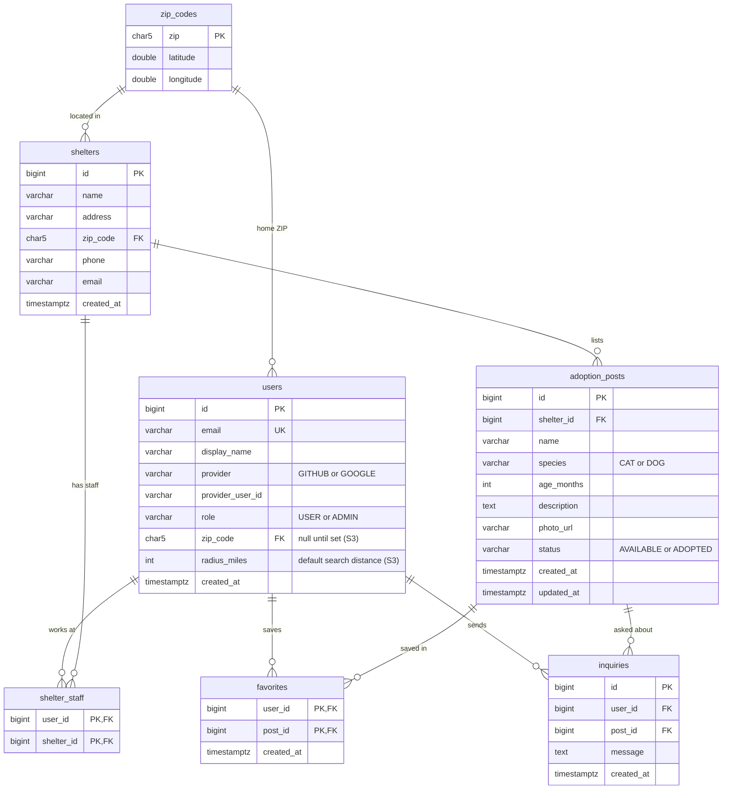

# ERD

Same model as the proposal slide, with column types. Story IDs are from `docs/prd.md`.
Change this file through a PR before changing a migration.

## Owners

| Table | Owner | Stories |
|---|---|---|
| `users` | Role 1 (auth and accounts) | S1–S4 |
| `shelters`, `shelter_staff`, `adoption_posts` | Role 2 (shelters and posts) | S6, S7, S10 |
| `zip_codes`, `users.zip_code`, `users.radius_miles` | Role 3 (nearby search) | S3, S5 |
| `favorites`, `inquiries` | Role 4 (favorites and inquiries) | S8, S9 |

## Rules

- `users` has a unique key on (`provider`, `provider_user_id`).
- A user is shelter staff for a shelter when a `shelter_staff` row exists. Only an admin adds or
  removes rows (S10).
- Staff can change only posts whose `shelter_id` is one of their shelters (S7).
- Nearby search returns only `AVAILABLE` posts, using the shelter's ZIP from `zip_codes` (S5, S7).
- Deleting a user deletes their `shelter_staff`, `favorites` and `inquiries` rows (S4).
- Deleting a post deletes its `favorites` and `inquiries`.
