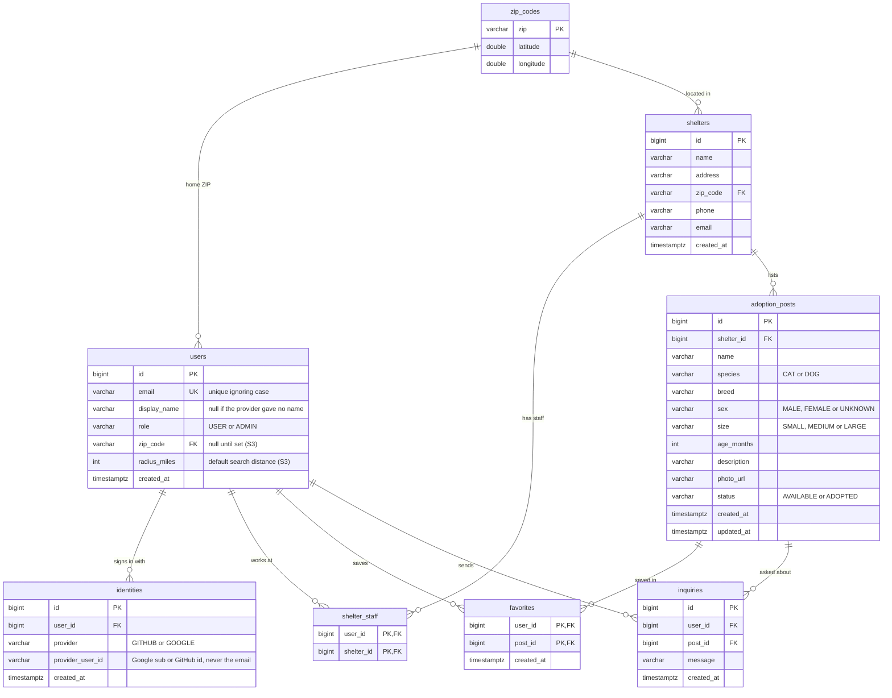

# ERD

Same model as the proposal slide, with column types. `users` and `identities` follow Appendix I,
section 3.5. Story IDs are from `docs/prd.md`. The schema is created by
`api/src/main/resources/db/migration/V1__init.sql`; change this file in the same PR as a migration.

## Owners

| Table | Owner | Stories |
|---|---|---|
| `users`, `identities` | Role 1 (auth and accounts) | S1–S4 |
| `shelters`, `shelter_staff`, `adoption_posts` | Role 2 (shelters and posts) | S6, S7, S10 |
| `zip_codes`, `users.zip_code`, `users.radius_miles` | Role 3 (nearby search) | S3, S5 |
| `favorites`, `inquiries` | Role 4 (favorites and inquiries) | S8, S9 |

## Rules

- `identities` has a unique key on (`provider`, `provider_user_id`); `users.email` is unique ignoring case.
  Signing in with the other provider on an email that is already registered returns 409 (Appendix I, 3.5).
- A shelter needs a phone or an email (or both).
- A user is shelter staff for a shelter when a `shelter_staff` row exists. Only an admin adds or
  removes rows (S10).
- Staff can change only posts whose `shelter_id` is one of their shelters (S7).
- Nearby search returns only `AVAILABLE` posts, using the shelter's ZIP from `zip_codes` (S5, S7).
- Deleting a user deletes their `identities`, `shelter_staff`, `favorites` and `inquiries` rows (S4).
- `adoption_posts.updated_at` is set by a database trigger on every update.
- Inquiries are one-way (S9): staff see the sender's email and answer outside the app.
- Deleting a post deletes its `favorites` and `inquiries`.
